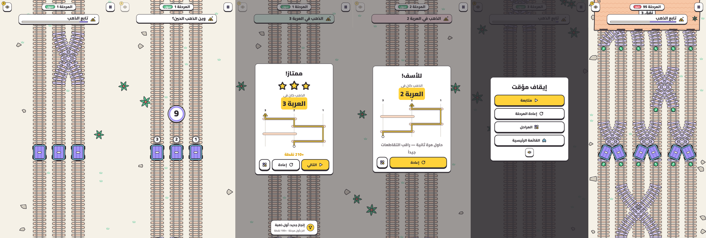

# عربة الذهب — Gold Rail 🚂🪙

لعبة Android للتتبّع والتركيز: الذهب داخل وحدة من العربات، تنقفل العربات وتتبادل أماكنها عبر التقاطعات والأنفاق… وعليك أن تعرف **وين الذهب الحين؟**



## 📦 ملف التثبيت (APK)

| الملف | الوصف |
|---|---|
| [`release/app-release.apk`](release/app-release.apk) | النسخة النهائية الموقّعة (Release) — هذه للتثبيت |
| [`release/app-debug.apk`](release/app-debug.apk) | نسخة اختبار (Debug) — تُثبَّت بجانب النسخة النهائية |

### طريقة التثبيت على الهاتف
1. انقل `app-release.apk` إلى الهاتف (أو حمّله مباشرة من GitHub عبر زر **Download raw file**).
2. افتح الملف من مدير الملفات.
3. إذا ظهرت رسالة "تثبيت التطبيقات من مصادر غير معروفة" اضغط **الإعدادات** وفعّل **السماح من هذا المصدر**، ثم ارجع واضغط **تثبيت**.
4. افتح **عربة الذهب** من قائمة التطبيقات. اللعبة تعمل بدون إنترنت.

> يتطلب Android 7.0 (API 24) أو أحدث. إذا كان Play Protect يحذّر من تطبيق غير معروف اختر "التثبيت على أي حال" — هذا طبيعي لأي تطبيق خارج Google Play.

## 🎮 المزايا
- **100 مرحلة** مولّدة بشكل حتمي (كل مرحلة مختلفة فعلياً — يتم التحقق من عدم التكرار) + مراحل مصمّمة يدوياً.
- مستويات الصعوبة: 1–10 سهل · 11–25 متوسط · 26–50 صعب · 51–75 احترافي · 76–100 خبير.
- آليات متدرجة: تبديل مفرد، **تبديل مزدوج**، **أنفاق** تخفي العربات، **مفاتيح خادعة** (إشارة حمراء = مستقيم)، **قفزات** فوق مسار، **دوران** جميع العربات، **ذهبتان**، **سرعة متغيرة**.
- 3 نجوم حسب الأداء، نقاط، مكافأة وشاشة احتفال عند إنهاء كل 10 مراحل، 19 إنجازاً، و"كاشف الذهب" (زر العين).
- فتح المراحل بالتسلسل، حفظ تلقائي محلي، إيقاف مؤقت، إعادة المرحلة، شرح مسار الذهب (مخطط) بعد كل محاولة.
- صوت مُركّب (بدون ملفات)، اهتزاز، وضع مريح، زر الرجوع في Android مدعوم.

## 🗂️ بنية المشروع
```
web/                 ← اللعبة نفسها (HTML/CSS/JS) — تُضمَّن كـ assets داخل الـ APK
  index.html
  css/style.css
  js/levels.js       ← نظام المراحل (أضف مراحل هنا)
  js/game.js         ← محرك الحركة والرسم (Canvas)
  js/app.js          ← الواجهات والقوائم والنتائج
  js/storage.js      ← الحفظ، النجوم، النقاط، الإنجازات
  js/audio.js        ← المؤثرات الصوتية
  fonts/             ← خط Cairo (رخصة OFL)
android/             ← مشروع Android (Gradle) — WebView أصلي بدون إنترنت
  app/src/main/java/com/adan/goldrail/MainActivity.java
  keystore/          ← مفتاح توقيع الإصدار
release/             ← ملفات APK الجاهزة
```

## ➕ إضافة مراحل جديدة
في `web/js/levels.js`:
- ارفع `LEVEL_COUNT` (مثلاً إلى 150) — المراحل الجديدة تكمل منحنى الصعوبة تلقائياً.
- أو صمّم مرحلة يدوياً داخل `CUSTOM_LEVELS`:
```js
CUSTOM_LEVELS[101] = {
  lanes: 5, golds: [2], speed: [380, 520], answerTime: 6, preview: 2,
  events: [ {type:'swap', a:1}, {type:'multi', pairs:[0,3]}, {type:'jump', a:0},
            {type:'swap', a:3, tunnel:true}, {type:'swap', a:2, decoy:true}, {type:'rotate', dir:1} ]
};
```
ثم أعد البناء.

## 🔨 البناء (Build)
المتطلبات: JDK 17+ و Android SDK (platform 35, build-tools 35).
```bash
cd android
echo "sdk.dir=/path/to/Android/Sdk" > local.properties
./gradlew assembleRelease   # → app/build/outputs/apk/release/app-release.apk
./gradlew assembleDebug     # → app/build/outputs/apk/debug/app-debug.apk
```
للتجربة السريعة في المتصفح افتح `web/index.html` مباشرة.

### التوقيع
`android/keystore.properties` + `android/keystore/goldrail-release.jks` يُستخدمان لتوقيع نسخة Release.
**احتفظ بنسخة احتياطية من هذا المفتاح** — بدونه لا يمكن نشر تحديثات تُثبَّت فوق النسخة الحالية.
إذا كان المستودع عاماً، انقل المفتاح وكلمة المرور خارج المستودع.

## الإصدار
1.0.0 — `com.adan.goldrail`
