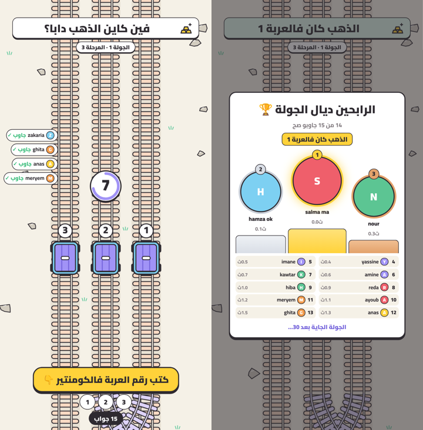

# تقرير الاختبارات — الإصدار 2.0.0 (TikTok LIVE)

## ✅ شنو تجرّب ونجح (فبيئة التطوير)

| الاختبار | النتيجة |
|---|---|
| بناء APK Release + Debug (Gradle 8.14، AGP 8.13، SDK 35)، توقيع v2، نفس المفتاح ديال 1.0 | ✅ |
| اختبارات السيرفر `npm test` (4): الاسم، استخراج التعليق والصورة، رفض token غالط، اتصال واحد لكل حساب، انتظار حساب ماشي LIVE حتى يبدا | ✅ 4/4 |
| **E2E**: السيرفر الحقيقي ⇄ WebSocket ⇄ اللعبة فـ Chromium (Pixel 7)، بمصدر TikTok مزيّف | ✅ 11/11 |
| ↳ «ماشي LIVE» ← «متصل ✓» ملي بدا البث | ✅ |
| ↳ التعليقات قبل السؤال ما كتتحسبش، وجواب واحد لكل مشاهد | ✅ |
| ↳ الأشكال `3`، `العربة ٣`، `3 🔥` كتتفهم | ✅ |
| ↳ المنصة 🥇🥈🥉 بترتيب السرعة + 10 أسماء من بعد | ✅ |
| ↳ إحصائيات المشاهدين والتعليقات والمشاركين | ✅ |
| ↳ تقطع WebSocket ← رجوع أوتوماتيكي | ✅ |
| وضع التجربة: جولات أوتوماتيكية، أزرار الصوت، اللوحة بضغطة طويلة، الترتيب العام | ✅ |
| حفظ تلقائي ← إعادة تحميل ← «كمّل الجلسة اللي فاتت» | ✅ |
| الجولة كتكمل حتى ملي كيتوقف `requestAnimationFrame` (بحال ملي التطبيق فالخلفية) | ✅ |
| اللعب العادي (100 مرحلة، نجوم، قفل/فتح، إيقاف…) ما تخرّبش | ✅ |

## ⏱️ اختبار التحمل: 30 دقيقة، 300 مشاهد وهمي، سؤال 10ث، المراحل 40→84

| الدقيقة | الذاكرة JS | عناصر الصفحة | الجولات | التعليقات | الحفظ المحلي | CPU* |
|---|---|---|---|---|---|---|
| 1 | 3.3 MB | 556 | 1 | 278 | 20 KB | 35% |
| 10 | 3.6 MB | 581 | 14 | 3,751 | 25 KB | 50% |
| 20 | 3.9 MB | 556 | 29 | 7,709 | 27 KB | 54% |
| 30 | 4.5 MB | 556 | 44 | 11,648 | 29 KB | 52% |

- **ما كاينش تسرب فالذاكرة:** بقات بين 3.3 و4.5 MB، وعدد العناصر ثابت.
- **0 أخطاء JavaScript.**
- الحفظ المحلي كيكبر شوية بزاف (29 KB فـ 30 دقيقة)، والحد ديال المشاركين 20,000.
- \*CPU فـ Chromium بلا GPU (الرسم بالمعالج)، فالرقم مبالغ فيه مقارنة مع تيليفون عندو GPU. وكيطلع مع المراحل الصعيبة حيت فيها سكك أكثر.

## ❌ شنو ما تجرّبش (وعلاش)

| الشي | السبب | كيفاش تجرّبو |
|---|---|---|
| **بث حقيقي فـ TikTok من تيليفون** | ما عنديش تيليفون ولا حساب TikTok، والشبكة ديال بيئة التطوير كتمنع `tiktok.com` و`eulerstream.com` | الدليل §7 |
| الاتصال الحقيقي بخوادم TikTok عبر `tiktok-live-connector` | نفس السبب | جرّب السيرفر على حساب آخر كيبث دابا (الدليل §7.4) |
| شكل رسائل Euler Stream المباشرة | الوثائق ما تقدّرش تتقرا من هنا. الـ parser مرن ولكن ما مجرّبش على الخدمة الحقيقية | إلا ما خدمش، استعمل السيرفر |
| البطارية والسخانة على تيليفون | ما كاينش جهاز ولا محاكي (ما كاينش KVM) | بث تجريبي 30 دقيقة، وشوف «ذاكرة اللعبة» فاللوحة |
| السلوك فالخلفية على Android حقيقي (Xiaomi/Samsung…) | نفس السبب | الدليل §7.3 |
